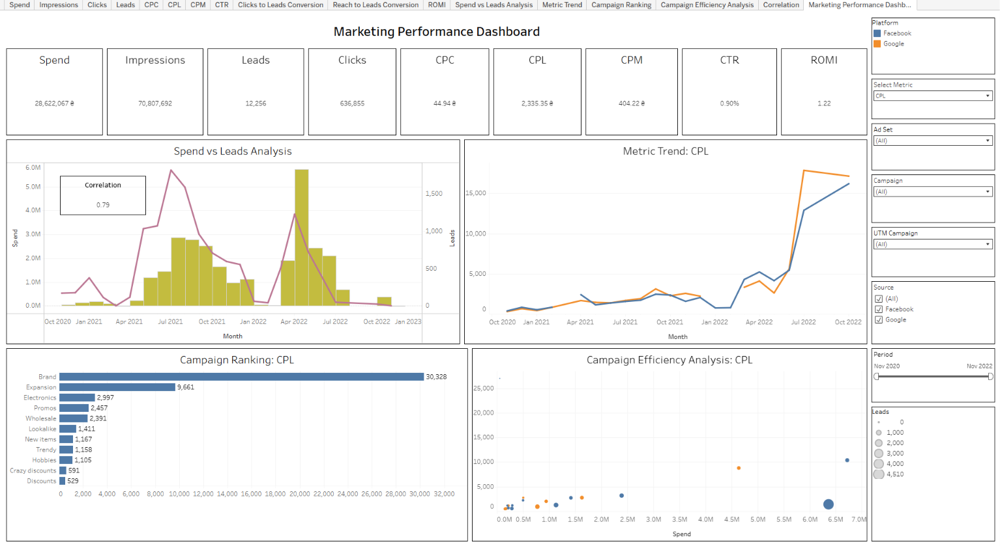

# Marketing Performance Dashboard (SQL + Tableau Public)

Interactive dashboard that compares Facebook Ads and Google Ads performance, built from raw multi-table data.

**Live dashboard:** [Tableau Public](https://public.tableau.com/views/Book4_17923248175590/MarketingPerformanceDashboard)



## Goal

Answer typical marketing analyst questions:
- Which campaigns and platforms are the most cost-efficient?
- How do spend, leads and funnel conversions change over time?
- Does a higher ad budget bring more leads?

## Tools

- **PostgreSQL** and **DBeaver** for data exploration and preparation
- **Tableau Public** for calculated fields, parameters, LOD expressions and dashboard design

## Data

Four tables in the `public` schema:

| Table | Type | Description |
|---|---|---|
| `facebook_ads_basic_daily` | Fact | Daily Facebook Ads metrics |
| `facebook_campaign` | Lookup | `campaign_id` to `campaign_name` |
| `facebook_adset` | Lookup | `adset_id` to `adset_name` |
| `google_ads_basic_daily` | Fact | Daily Google Ads metrics |

## SQL (`marketing_dashboard_dataset.sql`)

- Joins Facebook facts with campaign and ad set lookups
- Adds a `source` field and combines both platforms with `UNION ALL`
- Decodes URL parameters to extract `utm_campaign`
- Replaces NULL metrics with `COALESCE`
- Aggregates spend, clicks, impressions, reach, leads and value

## Tableau

**Calculated fields:** CTR, CPC, CPM, CPL, ROMI, Clicks to Leads Conversion, Reach to Leads Conversion

**LOD and statistics:** monthly leads and spend (`FIXED`), correlation between spend and leads

**Parameter:** `Select Metric` switches the metric (CTR, CPC, CPL, ROMI, conversions) across three charts

**Dashboard:**
- KPI cards: Spend, Impressions, Clicks, Leads, CTR, CPC, CPL, CPM, ROMI
- Spend vs Leads Analysis (dual axis with correlation)
- Metric Trend by platform
- Campaign Ranking
- Campaign Efficiency Analysis (scatter plot)
- Filter action from the scatter plot to other charts
- Filters: period, source, campaign, ad set, UTM campaign

## Key findings

- Total spend is 28.6M, and the ads brought 12,256 leads.
- Spend and leads move together. The correlation is 0.79, so a bigger budget usually gives more leads.
- Cost per lead (CPL) is 2,335 on average. It grew a lot in the second half of 2022 on both Facebook and Google.
- The "Brand" campaign has the highest CPL (about 30,000). The "Discounts" campaign has the lowest (about 530).
- The average CTR is low (0.90%), so the ads can be improved.
- ROMI is 1.22, so the ads brought more profit than they cost.

## Repository structure

```
.
├── README.md
├── marketing_dashboard_dataset.sql
└── Dashboard.png
```
